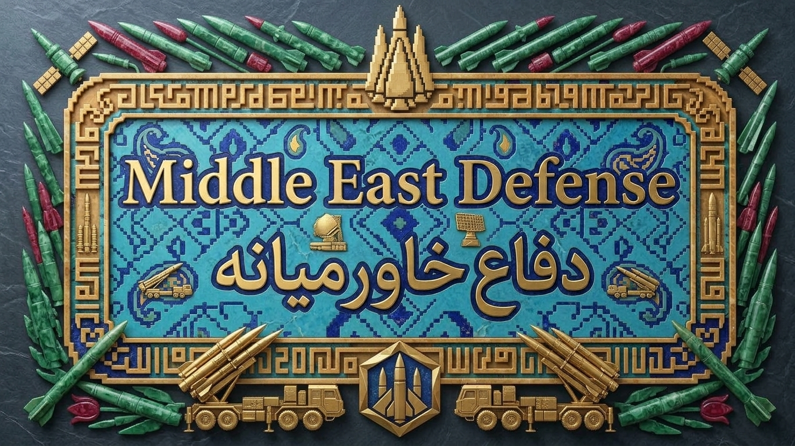

<p align="center">
  
</p>

<h1 align="center">دفاع خاورمیانه | Middle East Defense</h1>

**دفاع خاورمیانه** یک پروژهٔ بازی راهبردی آنلاین و چندنفره است که بر گسترش قلمرو، مدیریت نیروها و ساخت اتحادها تمرکز دارد. این مخزن نسخه‌ای تغییریافته و با هویت مستقل از پروژهٔ OpenFront است و برای ارائهٔ تجربه‌ای با محوریت خاورمیانه توسعه داده می‌شود.

این پروژه مستقل است و وابستگی یا تأیید رسمی از سوی OpenFront را ادعا نمی‌کند. کدها و دارایی‌های برگرفته از پروژه‌های پیشین همچنان تابع مجوزها و انتساب‌های اصلی خود هستند؛ تغییر نام و نشان پروژه به معنی ادعای مالکیت بر آثار بالادستی نیست.

## ویژگی‌ها

- بازی راهبردی هم‌زمان در مرورگر
- گسترش قلمرو و رقابت با بازیکنان دیگر
- ساخت اتحاد و همکاری یا رقابت گروهی
- نقشه‌ها و گزینه‌های مختلف برای تجربهٔ بازی
- رابط وب سازگار با مرورگرهای امروزی

## اجرا در محیط توسعه

### پیش‌نیازها

- Node.js نسخهٔ `24.15.0` یا جدیدتر از شاخهٔ 24
- npm نسخهٔ `12.1.0` یا جدیدتر از شاخهٔ 12
- مرورگر وب به‌روز

### نصب و اجرا

```bash
git clone https://github.com/Agh-sp/my-Daf.git
cd my-Daf
npm run inst
npm run dev
```

برای نصب وابستگی‌ها از `npm run inst` استفاده کنید؛ این فرمان `npm ci --ignore-scripts` را اجرا می‌کند تا وابستگی‌ها مطابق فایل قفل نصب شوند.

فرمان‌های دیگر:

```bash
npm run start:client     # اجرای کلاینت
npm run start:server-dev # اجرای سرور توسعه
npm test                 # اجرای آزمون‌ها
npm run lint             # بررسی کیفیت کد
npm run typecheck        # بررسی نوع‌های TypeScript
```

## ساختار مخزن

- `src/client` — رابط کاربری و کلاینت بازی
- `src/server` — سرور بازی
- `packages/engine` — شبیه‌سازی بازی
- `packages/engine-api` — قراردادها، نوع‌ها و طرح‌واره‌های موتور
- `packages/engine-lib` — کتابخانه‌ها و قواعد مشترک موتور
- `packages/shared` — کد مشترک کلاینت و سرور
- `packages/zbin` — قالب دودویی پیام‌ها
- `resources` — نقشه‌ها و دارایی‌های پروژه

## مشارکت

از گزارش خطا، پیشنهاد و مشارکت در توسعه استقبال می‌کنیم. پیش از ارسال تغییرات، راهنمای [مشارکت](CONTRIBUTING.md) را بخوانید و مجوز کد یا دارایی‌هایی را که اضافه می‌کنید بررسی کنید.

## مجوزها و انتساب

- کد پروژه تحت **GNU Affero General Public License نسخهٔ 3 (AGPL-3.0)** و شروط تکمیلی مندرج در [LICENSE](LICENSE) منتشر می‌شود.
- دارایی‌های `resources` و محتویات `proprietary` مجوزهای یکسانی ندارند. پیش از استفاده یا بازتوزیع، [LICENSE-ASSETS](LICENSE-ASSETS) و [LICENSING.md](LICENSING.md) را بخوانید؛ دارایی‌های پوشهٔ `proprietary` آزادانه قابل استفاده یا بازتوزیع نیستند.
- این نسخهٔ تغییریافته باید انتساب‌ها و اعلان‌های حق نشر لازم، از جمله اعلان «© OpenFront and Contributors» در محل‌های قابل مشاهدهٔ بازی، را مطابق [LICENSE](LICENSE) حفظ کند.
- نام و نشان «دفاع خاورمیانه» هویت این نسخه هستند و نباید به‌گونه‌ای استفاده شوند که آن را نسخهٔ رسمی OpenFront جلوه دهند.

مجوزها و اعلان‌های اصلی عمداً در این مخزن حفظ شده‌اند. حقوق هر اثر متعلق به پدیدآورنده یا دارندهٔ حق مربوط به همان اثر است؛ این معرفی ادعای مالکیت بر کد یا دارایی‌های بالادستی را مطرح نمی‌کند.
